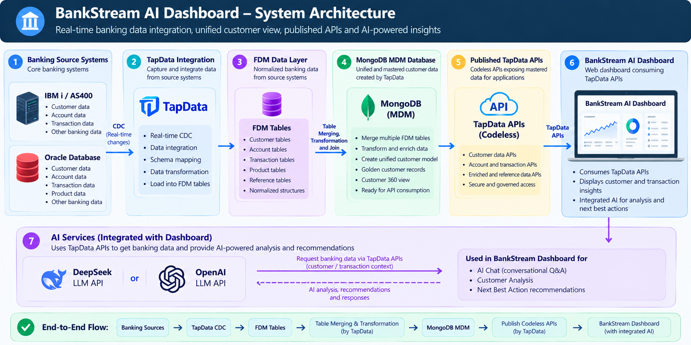
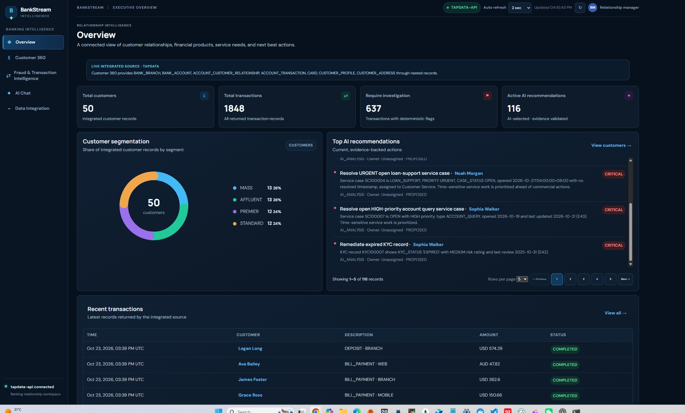

# BankStream AI Dashboard

## Introduction

The Customer 360 Banking Demo brings customer, account, transaction, and CRM data together from separate banking systems. **TapData CDC** captures changes, transformations build a unified **Customer 360** model in MongoDB, and **published APIs** supply the dashboard.

BankStream AI Dashboard displays this integrated data and provides **AI Analysis, AI Chat, and suggested next actions**. It is a reference application for internal training, partner demonstrations, and development.

## Architecture



```text
AS400 + Oracle → TapData CDC → FDM (MongoDB)
    → MDM (MongoDB Customer 360) → TapData APIs → AI Dashboard
```

AS400 holds core banking records, and Oracle holds CRM data. TapData replicates source data into FDM, then joins and transforms it into MongoDB MDM models. The dashboard reads published APIs through its Node.js backend. TapData maintains the models; API and AI credentials stay on the backend.

## Prerequisites

- Git, npm, and Node.js 22.9+ or 20.18+ for the dashboard.
- IBM i / AS400 (DB2 for i) and Oracle with demo schemas and sample data.
- TapData and MongoDB, with network access and permissions for CDC, transformations, and API publishing.
- Published TapData API URLs and authentication credentials accessible from the dashboard host.
- A DeepSeek or OpenAI API key and provider connectivity for live AI features.

The complete demo uses two repositories: **BankStream Feeder** for source preparation, activity, integration, and APIs, and **BankStream_AI_Dashboard** for the user interface. The Feeder repository includes the TapData tasks, configuration files, and setup instructions. Each repository documents its own setup requirements.

## Deployment Guide

For source database and TapData pipeline setup, follow the [BankStream Feeder README](https://github.com/umerwhu/BankStream_Feeder#readme). Once the published APIs are available, install and configure the dashboard below.

1. **Clone the dashboard repository.**

   ```sh
   git clone https://github.com/umerwhu/BankStream_AI_Dashboard.git
   cd BankStream_AI_Dashboard
   ```

2. **Install dependencies.**

   ```sh
   npm ci
   ```

3. **Copy the example configuration.** Choose the command for your terminal.

   Windows PowerShell:

   ```powershell
   Copy-Item .env.example .env
   ```

   Linux/macOS:

   ```sh
   cp .env.example .env
   ```

4. **Choose sample data or live data.** Set one of these values in `.env`:

   | Value | Dashboard data | What `npm test` does |
   | --- | --- | --- |
   | `DATA_SOURCE=demo` | Sample data; no TapData connection needed. | Runs application tests and skips real TapData API calls. |
   | `DATA_SOURCE=tapdata` | Real data from TapData. | Also calls the 13 TapData APIs that feed the dashboard and checks that each returns records. |

5. **Optional: enable AI Analysis and AI Chat.** In `.env`, set `AI_PROVIDER`, `AI_MODEL`, `AI_BASE_URL`, and your provider's key: `DEEPSEEK_API_KEY` or `OPENAI_API_KEY`. See [.env.example](.env.example) for examples. You can skip this step to view dashboard data and run `npm test`.

6. **Run tests and start the dashboard.** If you chose `demo`, no TapData credentials are needed. If you chose `tapdata`, first set these four values in `.env`:

   ```ini
   # Partners using TapData-hosted databases and the TapData Console UI to publish APIs:
   # Use public IP 113.98.206.139 as the host in both URLs below. Use the ports provided by TapData and keep the URL paths unchanged.
 
 
   # Partners using their own database and TapData environment: use your own TapData host IP and ports in both URLs.
   TAPDATA_API_BASE_URL=http://127.0.0.1:3080
   TAPDATA_TOKEN_URL=http://127.0.0.1:3030/oauth/token
   TAPDATA_CLIENT_ID=YOUR_TAPDATA_CLIENT_ID
   TAPDATA_CLIENT_SECRET=YOUR_TAPDATA_CLIENT_SECRET
   ```

   Use your real client ID and secret. Change the URLs if TapData runs on another computer or different ports. Keep the other TapData settings from `.env.example` for the reference setup. These same values connect tVhe live dashboard to TapData. Keep `.env` and real credentials out of Git.

   From the dashboard folder, run:

   ```sh
   npm test
   ```

   If `npm test` fails only on the live TapData checks, you can still run the start commands below to explore the dashboard. However, live data may be missing or incomplete, so its accuracy cannot be guaranteed until the TapData issue is fixed. Check your connection and credentials, or use `DATA_SOURCE=demo` for sample data. Investigate any other test failures before continuing.

   Start the dashboard:

   ```sh
   npm run service:start
   npm run service:status
   ```

7. **Open http://127.0.0.1:3001.** Confirm customer and transaction data appears, then try AI Analysis and AI Chat. Restart with `npm run service:restart` after changing `.env`.

   For foreground operation, use `npm start` and stop with **Ctrl+C**. Background mode does not automatically restart after a computer reboot.

For a UI preview without live integration, set `DATA_SOURCE=demo`. Sample data does not demonstrate CDC.

**Optional LAN access:** Set `HOST=0.0.0.0` and the desired `PORT` in `.env`, restart, and use the LAN URL shown by service status from another computer. The `HOST=127.0.0.1` allows access only on the host. `0.0.0.0` is a listening address, not a browser URL. Your host firewall and network must permit the connection; the application does not configure them. Production requires the existing trusted identity proxy and network controls.

## Live CDC Demonstration

1. Open the dashboard and go to **Customer 360**. Search for customer ID **100002** and open their details. In **Accounts**, find the **Checking** account with account ID **1000021** and note its balance. Review the transactions for this account and note a transaction amount, then open **KYC** and note the current KYC status. Compare these values after making the source changes below.
2. In TapData, confirm that the source-to-FDM replication tasks and FDM-to-MDM transformation tasks are running, and that the published APIs are available. Keep these tasks and APIs running during the demo.
3. Use BankStream Feeder to generate a transaction or KYC update for that customer. Follow the [Feeder README](https://github.com/umerwhu/BankStream_Feeder#demo-commands) for all simulation and verification commands.
4. Allow time for the source changes to reach MDM and appear in the API results. Refresh or reopen the dashboard view and confirm the same customer's updated information.

## Dashboard Features



| Area | What it shows |
| --- | --- |
| Overview | Customer and transaction KPIs, segments, and top recommendations. |
| Customer 360 | Unified customer details and related banking information. |
| Transaction & Fraud Intelligence | Transaction activity, filters, review signals, and investigation context. |
| AI Analysis | AI-assisted insights from available customer data. |
| AI Chat | Natural-language questions through the configured AI provider. |
| Next Best Actions | Suggested service or engagement follow-ups. |

Fraud indicators are deterministic review signals, not confirmed fraud. AI suggestions require human review before any banking action.

## Essential Dashboard Commands

Run these from the dashboard repository:

| Action | Command |
| --- | --- |
| Start in the background | `npm run service:start` |
| Stop with confirmation | `npm stop` |
| Restart | `npm run service:restart` |
| Show status and addresses | `npm run service:status` |
| View recent logs | `npm run logs` |

At the stop prompt, enter `y` to stop; other answers cancel. For non-interactive shutdown, use `npm stop -- --yes`. Restart does not ask for shutdown confirmation.

## Troubleshooting

| Problem | What to do |
| --- | --- |
| Dashboard cannot start | Check Node.js version, run `npm ci`, confirm `.env` is in the project folder, and check that the configured port is free. View `npm run logs`. |
| TapData API connection fails | Check API URL/path, published service names, OAuth credentials, and network access. See [API integration details](docs/api-integration.md). |
| Customer or transaction data is missing | Confirm `DATA_SOURCE=tapdata` and restart. Check API results, service mappings, and scan limits in the [integration guide](docs/api-integration.md). |
| AI features do not work | Check provider, model, API root, key, and connectivity. Restart after configuration changes and inspect backend logs. |

For source database or simulation issues, use the [Feeder documentation](https://github.com/umerwhu/BankStream_Feeder#readme). For replication, transformation, or API publishing issues, use the [BankStream Feeder repository](https://github.com/umerwhu/BankStream_Feeder).

## Related Projects

| Repository | Purpose |
| --- | --- |
| [BankStream Feeder](https://github.com/umerwhu/BankStream_Feeder) | Source schema/sample-data scripts and commands to generate banking activity. |
| [BankStream AI Dashboard](https://github.com/umerwhu/BankStream_AI_Dashboard) | Customer 360 dashboard, transaction intelligence, and AI-assisted insights. |
