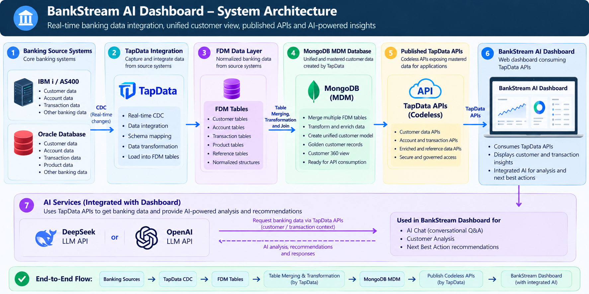
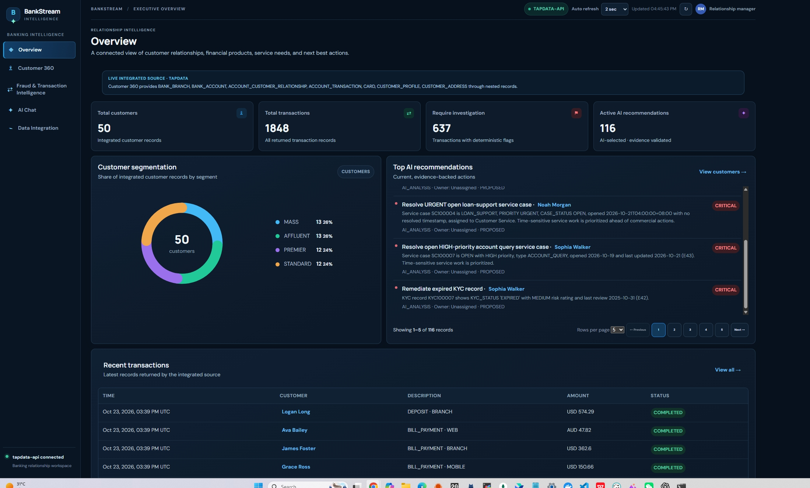

# BankStream AI Dashboard

A web dashboard for banking data. It includes Overview, Customer 360, transaction review, AI Analysis, AI Chat, and data integration status.

## How the pieces connect





TapData carries changes from the banking sources into the target configured for your deployment and exposes data through published APIs. BankStream reads data through its backend; the browser does not call TapData directly. `DATA_SOURCE` selects one source (`demo`, `tapdata`, `mongodb`, or `api`) at a time. It does not combine sources. AI keys stay on the backend. Fraud indicators are deterministic review signals, not confirmed fraud.

## Run it locally

You need Node.js 22.9+ (or 20.18+) and npm.

1. Clone the repository and open a terminal in `BankStream_AI_Dashboard`.
2. Install dependencies:

   ```sh
   npm ci
   ```

3. Copy `.env.example` to `.env` using your file manager or your terminal's copy command.
4. Start the app:

   ```sh
   npm start
   ```

5. Open **http://127.0.0.1:3001**. Press **Ctrl+C** in the terminal to stop the foreground app.

The example configuration starts in demo mode and needs no banking connection. Edit `.env` to enable integrations. The `.env` file is private and must not be committed.

## Run it in the background

Start the dashboard as a background process. It keeps running after you close the terminal:

```sh
npm run service:start
```

Use these commands to manage it:

| Command | What it does |
| --- | --- |
| `npm run service:start` | Start in the background |
| `npm run status` | Check whether it is running |
| `npm run logs` | Show recent application logs |
| `npm run restart` | Restart after changing `.env` |
| `npm stop` | Stop the background process |

Logs and the process ID are saved under `STATE_DIR` (by default, `var/`). The background process does not automatically restart after a machine reboot; use your host's service manager for that.

## Connect real data and AI

- **TapData:** Set `DATA_SOURCE=tapdata` and replace the example API URL and OAuth placeholders in `.env` with values from your TapData deployment. The published service names and routes must match that deployment.
- **DeepSeek / OpenAI:** Set the provider and add its API key in `.env` to enable AI Analysis and AI Chat.
- **Other data sources:** Set `DATA_SOURCE=mongodb` or `DATA_SOURCE=api` and fill in the matching settings in `.env`.
- **Workflow storage:** Local JSON is used by default. PostgreSQL can be enabled with `DATABASE_URL`.

See [docs/api-integration.md](docs/api-integration.md) for TapData configuration details and [docs/architecture.md](docs/architecture.md) for data joins and business rules.

## Check the app

Run the automated tests:

```sh
npm test
```

If the app does not start, check that Node.js is installed, port 3001 is free, and `.env` is in the dashboard folder. If TapData or AI features are unavailable, confirm the corresponding URL and credentials in `.env`, then restart the app.

## Deployment and security

For a background deployment, run the app with a process manager or service manager suitable for your host, configured to start in this project folder and load its `.env`. Keep API keys and passwords in `.env` or a deployment secret manager; never put them in frontend files or `.env.example`. Use a trusted identity gateway and TLS before exposing the app to users. Do not treat a successful API request as proof of TapData CDC health; that requires actual pipeline monitoring data.
